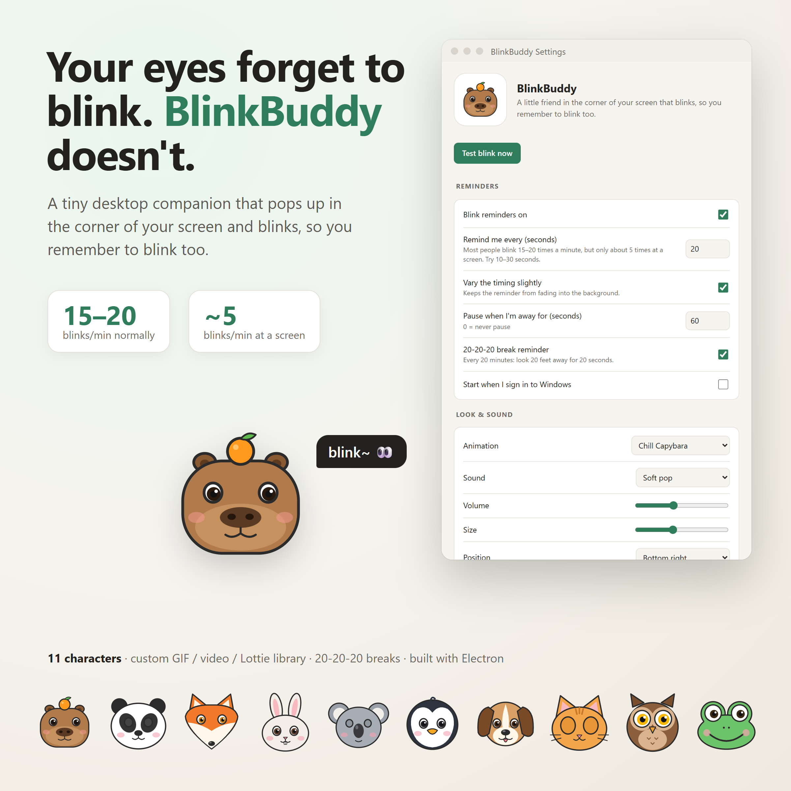

# BlinkBuddy 👀

**Your eyes forget to blink. BlinkBuddy doesn't.**

A tiny, open-source desktop companion that lives in your system tray. Every ~20 seconds, a cute character pops up
in the corner of your screen and **blinks**, a gentle nudge for you to blink too.



## Why?

People normally blink about 15–20 times a minute, but that drops sharply while staring at a screen.
Fewer blinks means dry, tired, sometimes painful eyes. BlinkBuddy started from a conversation with a friend
about exactly that, and it's meant to be a reminder so gentle (and cute) you actually *want* to see it.

## Features

- 🐾 **11 built-in characters**: Friendly Eyes, Cat, Owl, Frog, Capybara 🍊, Panda, Pup, Bunny, Fox, Koala, and Penguin
- 🔊 **Built-in sounds** (pop, chime, boing), or use your own
- 🎞️ **Your own animation library**: GIF, WebP, APNG, PNG, WebM, MP4, or Lottie JSON
- ✂️ **Automatic white-background removal**, so only the character shows
- 🎬 **Videos play their own sound**
- 🖱️ **Click-through overlay** that never gets in your way
- ⏸️ **Pauses when you're away**, or pause it from the tray for 15 min to 2 h
- 👁️ **Optional 20-20-20 break reminders** (every 20 min, look 20 ft away for 20 s)
- 🚀 **Can start with Windows**

## Install

Download the latest installer from the [Releases](https://github.com/emomo81/BlinkBuddy/releases) page and run it.

> Windows SmartScreen may warn you because the installer isn't code-signed yet. Click **More info → Run anyway**.

## Run from source

Requires [Node.js](https://nodejs.org/) 20 or newer.

```bash
git clone https://github.com/emomo81/BlinkBuddy.git
cd BlinkBuddy
npm install
npm start
```

Build the Windows installer (output goes to `dist/`):

```bash
npm run dist
```

## Using it

- Click the **eye icon** in the system tray to open Settings & Library.
- Right-click it for **Blink now**, **Pause**, and **Quit**.
- **Add animations…** / **Add sounds…** copy files into your personal library at `%APPDATA%\BlinkBuddy\library`.

## Where to find animations & sounds

Always check each file's license. For anything you share or bundle, prefer **CC0 / public domain** and credit
sources in `library/CREDITS.md`.

| Source | Good for | License notes |
|---|---|---|
| [LottieFiles](https://lottiefiles.com/free-animations/eye-blinking) | Blinking eyes and animals (Lottie JSON) | Free animations allow commercial use; check each file |
| [Lordicon](https://lordicon.com) | Animated eye icons | Free tier needs attribution |
| [OpenGameArt](https://opengameart.org) / [Kenney](https://kenney.nl) | Animal sprites and sounds | Filter for CC0 / all CC0 |
| [Freesound](https://freesound.org) | Blink, pop, and twinkle sounds | Filter for Creative Commons 0 |
| Pixabay Sound Effects | Short UI sounds | Free, no attribution needed |
| [ElevenLabs Sound Effects](https://elevenlabs.io/sound-effects/cartoon-blink) | Cartoon blink sounds | Royalty-free |
| GIPHY / Tenor | Fun GIFs | ⚠️ Usually copyrighted characters, so personal use only |

## Roadmap

- [ ] Character packs with a `pack.json` (name, author, license, tags)
- [ ] Online pack catalog you can browse from the app
- [ ] On-device **webcam blink detection** (MediaPipe) that reminds you only when you haven't blinked
- [ ] Daily blink and break stats
- [ ] macOS and Linux builds
- [ ] More characters: hamster, sloth, axolotl…

## Contributing

Contributions are welcome, especially new characters! See [CONTRIBUTING.md](CONTRIBUTING.md).

## Project layout

```
src/main.js        tray, timer, overlay window, settings storage, library scanning
src/overlay.*      transparent click-through pop-up: plays the animation + sound
src/shared.js      built-in SVG characters + synthesized sounds
src/settings.*     settings & library window
library/           files bundled with the app (animations/, sounds/)
build/icon.png     app icon
```

## License

[MIT](LICENSE) © Emmanuel Momo
